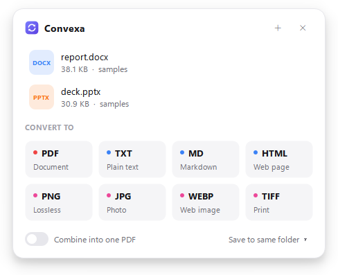

# Convexa

A minimal, fully local file converter for Windows. It lives in the system tray, starts with Windows, and opens a small popup where you pick the format you want. There are no cloud calls, and it doesn't need Office or LibreOffice.

<p align="center">
  <picture>
    <source media="(prefers-color-scheme: dark)" srcset="docs/screenshot-dark.png">
    
  </picture>
</p>

## Setup

Requires Windows 10/11 and [Python 3.10+](https://www.python.org/downloads/).

```
git clone https://github.com/<your-username>/convexa.git
cd convexa
setup.bat
```

Run `setup.bat` once. It creates `.venv`, installs the libraries from `requirements.txt` and starts Convexa. On first launch Convexa:

- adds itself to Windows startup
- adds **Convert with Convexa** to the Explorer right-click menu (on Windows 11 it's under *Show more options*)
- creates a Start-menu shortcut

You can switch each of these off from the tray menu.

## Use

| How | What happens |
|---|---|
| Select files in Explorer → **Ctrl+Alt+C** | Popup opens with those files |
| **Ctrl+Alt+C** anywhere else | Toggles the empty popup (drop or browse files) |
| Right-click file(s) → Convert with Convexa | Popup opens with the selection |
| Click the tray icon | Toggles the popup |

Click a format to convert. Output goes next to the original file by default; to change that, use **Save to …** at the bottom of the popup. If you pick several files you can **Combine into one PDF** (or one PowerPoint for images). To change the shortcut, use tray → *Shortcut: …*.

## Formats

| From | To |
|---|---|
| DOCX, TXT, MD, HTML | PDF, DOCX, TXT, MD, HTML, PPTX, PNG/JPG/WEBP/TIFF (pages), XLSX/CSV (tables) |
| PDF | DOCX (layout-preserving), TXT, MD, HTML, PPTX, XLSX/CSV (tables), PNG/JPG/WEBP/TIFF |
| PPTX | PDF, PNG/JPG/WEBP/TIFF (slides), DOCX, TXT, MD, HTML |
| XLSX, XLS, CSV, TSV, JSON | XLSX, CSV, TSV, JSON, PDF, DOCX, HTML, MD, TXT |
| PNG, JPG, WEBP, BMP, GIF, TIFF, ICO, SVG | PNG, JPG, WEBP, BMP, GIF, TIFF, ICO, PDF, DOCX, PPTX |

Multi-page image output is written to a folder named after the source file.

**Limits.** Office → PDF is a local re-render rather than Office's own engine. Text, tables, images and basic layout carry over, but complex layouts, charts, SmartArt and theme effects are simplified. Legacy `.doc` and `.ppt` are not supported (re-save them as `.docx`/`.pptx`).

## Command line

```
.venv\Scripts\python -m convexa.cli report.docx --to pdf
.venv\Scripts\python -m convexa.cli a.png b.jpg --to pdf --combine
.venv\Scripts\python -m convexa.cli data.xlsx          # list possible targets
```

## Uninstall

Run `uninstall.bat`. It removes autostart, the right-click entry and the shortcut, and closes Convexa. Then delete the folder.

## Layout

```
convexa.pyw            entry point (tray app)
convexa/app.py         tray, single instance, hotkey wiring
convexa/system.py      settings, global hotkey, Explorer selection, registry
convexa/ui/            popup, theme (light/dark), logo
convexa/engine/        converters: docs, sheets, slides, images, pdfs
assets/logo.svg        logo (logo.ico generated from it)
```

## License

Copyright (C) 2026 Khayal Aghazada

Convexa is free software: you can redistribute it and/or modify it under the terms of the [GNU Affero General Public License v3.0](LICENSE). It is distributed without any warranty.

Convexa uses [PyMuPDF](https://github.com/pymupdf/PyMuPDF) (AGPL-3.0), [PySide6](https://doc.qt.io/qtforpython-6/) (LGPL-3.0), and [python-docx](https://github.com/python-openxml/python-docx), [openpyxl](https://foss.heptapod.net/openpyxl/openpyxl), [python-pptx](https://github.com/scanny/python-pptx), [pdf2docx](https://github.com/ArtifexSoftware/pdf2docx), [Pillow](https://github.com/python-pillow/Pillow), [Markdown](https://github.com/Python-Markdown/markdown), [pywin32](https://github.com/mhammond/pywin32) and [xlrd](https://github.com/python-excel/xlrd), all under permissive licenses.
